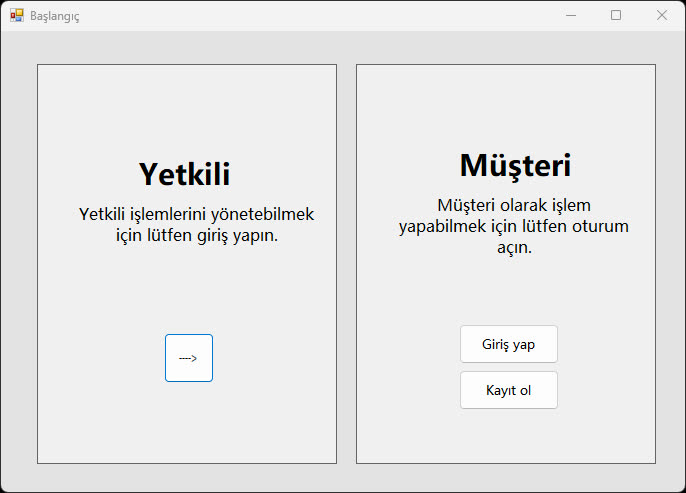
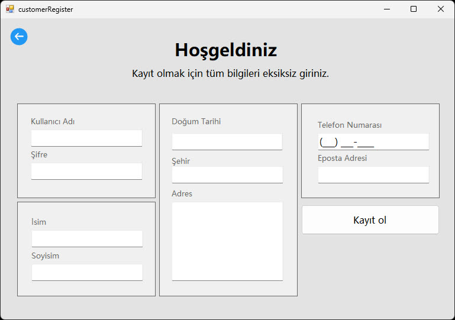
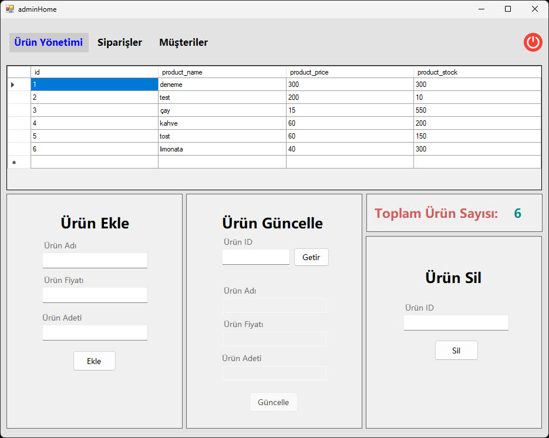
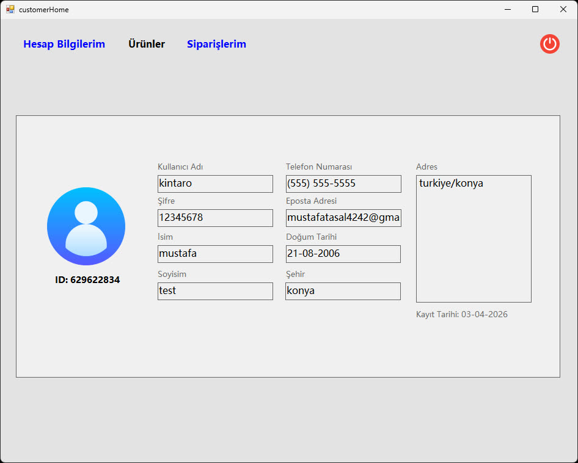
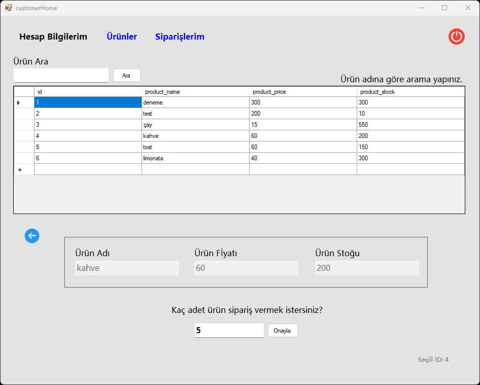
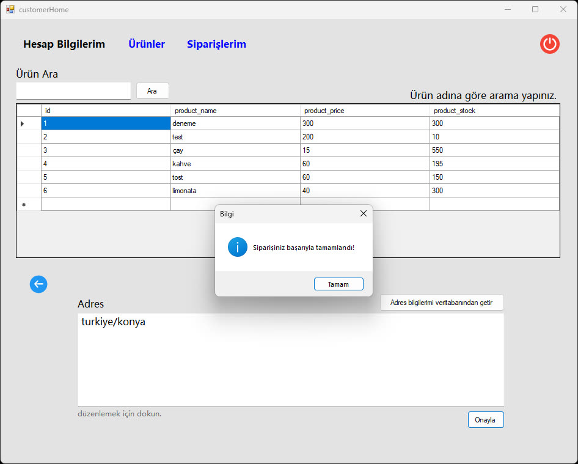

<a href="README.md">
  
</a>
<a href="README-TR.md">
  
</a>

  <br />
  <br />

<div align="center">
  
  <br />
  <br />

  <p>
     C# WinForms ve MySQL ile hazırlanmış basit bir stok takip uygulaması.
  </p>


  <p>
    <a href="#about">Hakkında</a> •
    <a href="#features">Özellikler</a> •
    <a href="#tech">Teknolojiler</a> •
    <a href="#setup">Kurulum</a> •
    <a href="#gallery">Galeri</a> •
    <a href="#license">Lisans</a>
  </p>

  <br />
  <br />
</div>

## <a id="about"></a> 📋 Hakkında

Bu proje, lise yıllarımda C# WinForms ve MySQL kullanarak hazırladığım bir dönem ödevi. İçeriği oldukça basit ve anlaşılır tutmaya çalışmıştım. Temel olarak; ürün ekleme, silme, güncelleme gibi stok takip işlemlerini yapabiliyorsunuz. Ayrıca hem kullanıcı hem de yönetici girişi gibi özellikleri de mevcut. Eski ama hatırası olan bir çalışma olduğu için burada paylaşıyorum.

Uygulamanın iki tarafı vardır. Yetkililer ürünleri yönetir, müşterileri ve siparişleri görüntüler. Müşteriler ise kayıt olur, ürünlere göz atar ve sipariş verir. Verilen her sipariş, ürünün veritabanındaki stoğunu düşürür.

## <a id="features"></a> ✨ Özellikler

- **Yetkili paneli**: Ürün ekleyin, güncelleyin ve silin, bir ürünü ID'siyle bulun, ürün, müşteri ve sipariş listelerini toplam sayılarıyla birlikte görüntüleyin.
- **Müşteri kaydı**: Kişisel bilgilerinizle kayıt olun. Uygulama, kullanıcı adının boşta olduğunu, şifrenin en az 8 karakter olduğunu ve doğum tarihinin geçerli olduğunu kontrol eder.
- **Ürün arama**: Ürünleri adına göre arayın, fiyatlarını ve stoklarını görün.
- **Sipariş verme**: Ürünü ID'siyle seçin, adedi girin ve teslimat adresini onaylayın. Adresinizi tek tıkla hesabınızdan doldurabilirsiniz.
- **Stok kontrolü**: Stoğu tükenmiş ürünler ve mevcut stoktan fazla adetler için sipariş verilemez.
- **Hesap ve siparişler**: Hesap bilgilerinizi ve geçmiş siparişlerinizi görüntüleyin.

## <a id="tech"></a> 🛠️ Teknolojiler

`C#` · `.NET Framework` · `Windows Forms` · `MySQL` · `MySql.Data`

## <a id="setup"></a> 🚀 Kurulum

### Gereksinimler

- **Windows**
- **Visual Studio**
- **.NET Framework 4.7.2**
- **MySQL**

### Adım Adım Kurulum

1. **Depoyu klonlayın**

   ```bash
   git clone https://github.com/xkintaro/stock-app.git
   cd stock-app
   ```

2. **Veritabanını kurun**

   MySQL'de `stockapp` adında bir veritabanı oluşturun ve `stockapp.sql` dosyasını bu veritabanına içe aktarın.

   Uygulama varsayılan olarak `root` kullanıcısı ve boş şifreyle bağlanır. MySQL ayarlarınız farklıysa `stockApp/App.config` dosyasındaki bağlantı bilgisini güncelleyin.

3. **Projeyi açın**

   `stockApp.sln` dosyasını Visual Studio ile açın. NuGet paketleri, projeyi derlediğinizde otomatik olarak yüklenir.

4. **Uygulamayı çalıştırın**

   Uygulamayı derleyip başlatmak için `F5` tuşuna basın. Yetkili paneline `admin` kullanıcı adı ve `123` şifresiyle giriş yapabilirsiniz.

## <a id="gallery"></a> 🖼️ Galeri













## <a id="license"></a> 📄 Lisans

Bu proje MIT Lisansı altında lisanslanmıştır. Detaylar için [LICENSE](LICENSE) dosyasına bakabilirsiniz.

#

<p align="center">
  <sub>❤️ Developed by "Mustafa TAŞAL" (kintaro)</sub>
</p>
