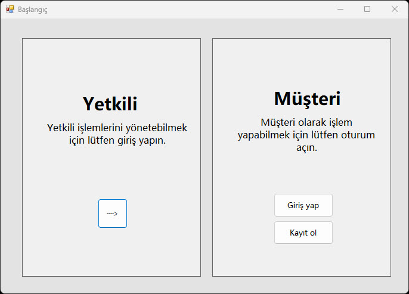
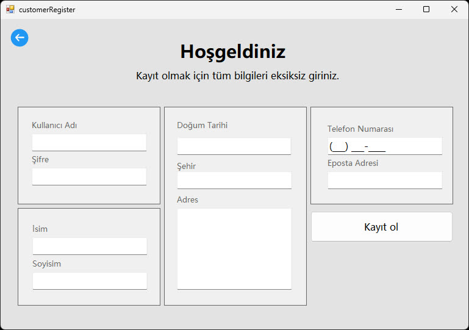
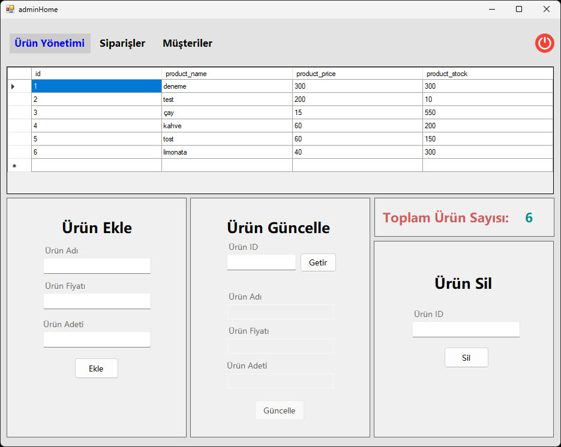
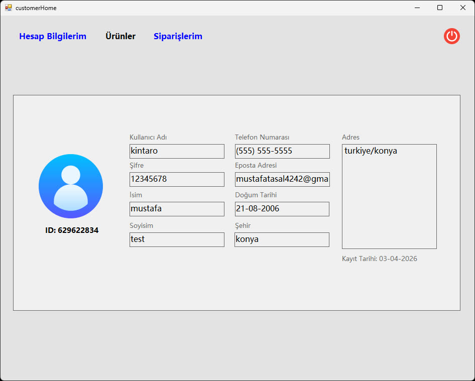
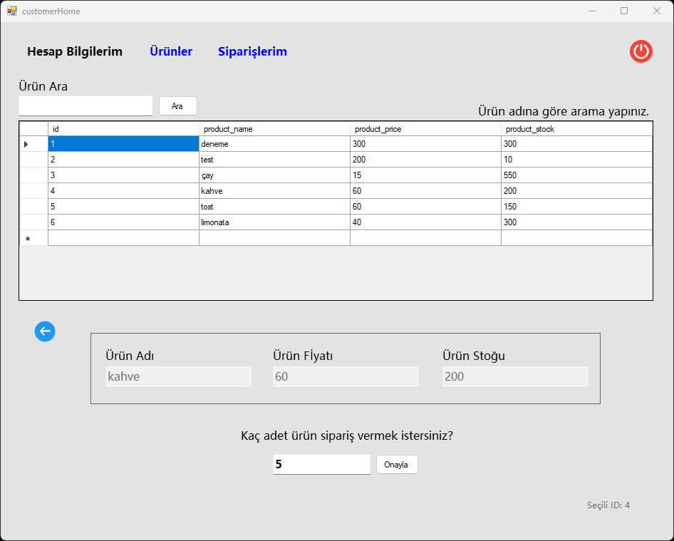
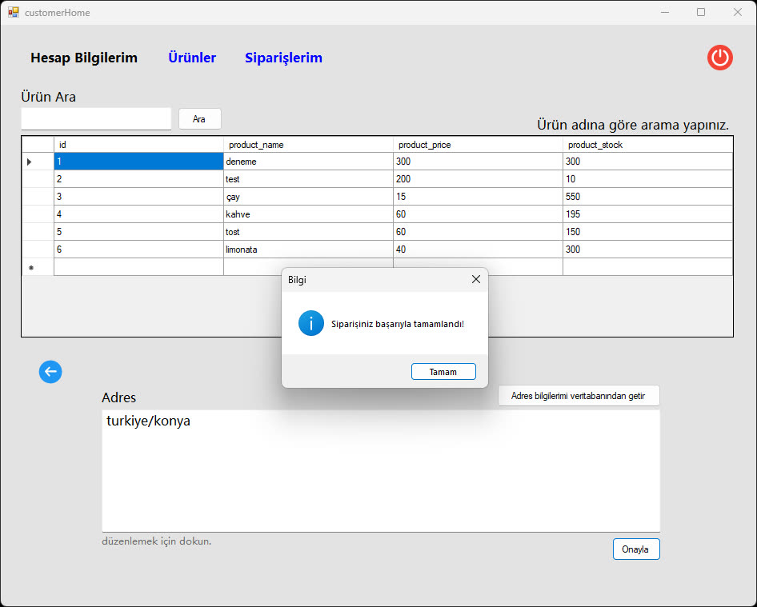

<a href="README.md">
  
</a>
<a href="README-TR.md">
  
</a>

  <br />
  <br />

<div align="center">
  
  <br />
  <br />

  <p>
     A simple stock management app built with C# WinForms and MySQL.
  </p>


  <p>
    <a href="#about">About</a> •
    <a href="#features">Features</a> •
    <a href="#tech">Tech</a> •
    <a href="#setup">Setup</a> •
    <a href="#gallery">Gallery</a> •
    <a href="#license">License</a>
  </p>

  <br />
  <br />
</div>

## <a id="about"></a> 📋 About

This is a high school project I developed as an assignment using C# WinForms and MySQL. It’s a simple stock management system where you can perform basic operations like adding, deleting, and updating products. It also features separate login systems for users and admins. I’m sharing it as it is, as a nice memory from my high school years.

The app has two sides. Admins manage products and view customers and orders, while customers register, browse products, and place orders. Every order reduces the product’s stock in the database.

## <a id="features"></a> ✨ Features

- **Admin panel**: Add, update, and delete products, look up a product by its ID, and view the product, customer, and order lists with their totals.
- **Customer registration**: Sign up with your personal details. The app checks that the username is free, the password is at least 8 characters long, and the birth date is valid.
- **Product search**: Search products by name and see their price and stock.
- **Ordering**: Choose a product by its ID, enter the quantity, and confirm the delivery address. You can fill in the address from your account with one click.
- **Stock control**: Orders are blocked for products that are out of stock or for quantities above the available stock.
- **Account and orders**: View your account details and your past orders.

## <a id="tech"></a> 🛠️ Tech

`C#` · `.NET Framework` · `Windows Forms` · `MySQL` · `MySql.Data`

## <a id="setup"></a> 🚀 Setup

### Requirements

- **Windows**
- **Visual Studio**
- **.NET Framework 4.7.2**
- **MySQL**

### Step-by-Step Installation

1. **Clone the repository**

   ```bash
   git clone https://github.com/xkintaro/stock-app.git
   cd stock-app
   ```

2. **Set up the database**

   Create a database named `stockapp` in MySQL and import the `stockapp.sql` file into it.

   The app connects with the `root` user and an empty password by default. If your MySQL settings are different, update the connection string in `stockApp/App.config`.

3. **Open the project**

   Open `stockApp.sln` in Visual Studio. The NuGet packages are restored automatically when you build the project.

4. **Run the app**

   Press `F5` to build and start the app. You can sign in to the admin panel with the username `admin` and the password `123`.

## <a id="gallery"></a> 🖼️ Gallery













## <a id="license"></a> 📄 License

This project is licensed under the MIT License. See the [LICENSE](LICENSE) file for details.

#

<p align="center">
  <sub>❤️ Developed by "Mustafa TAŞAL" (kintaro)</sub>
</p>
